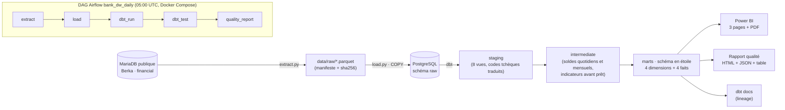
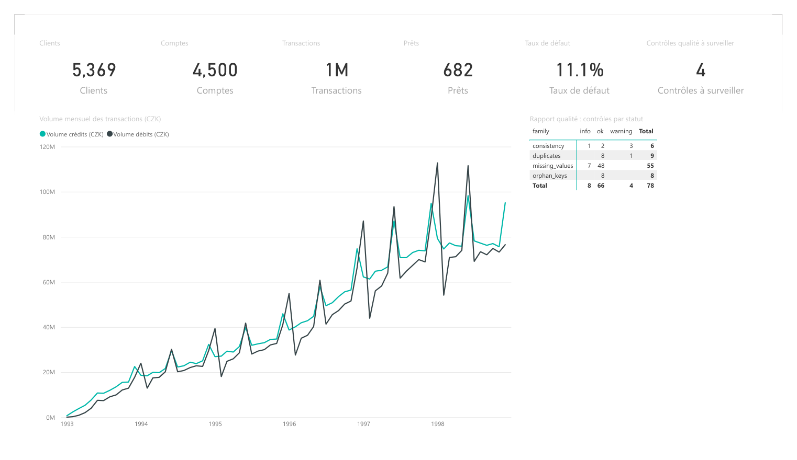
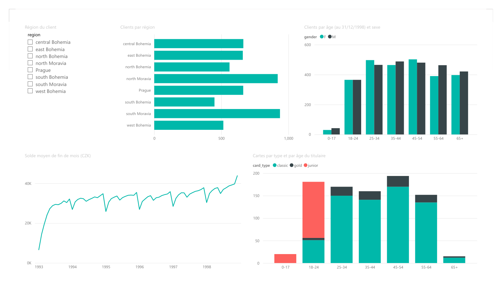
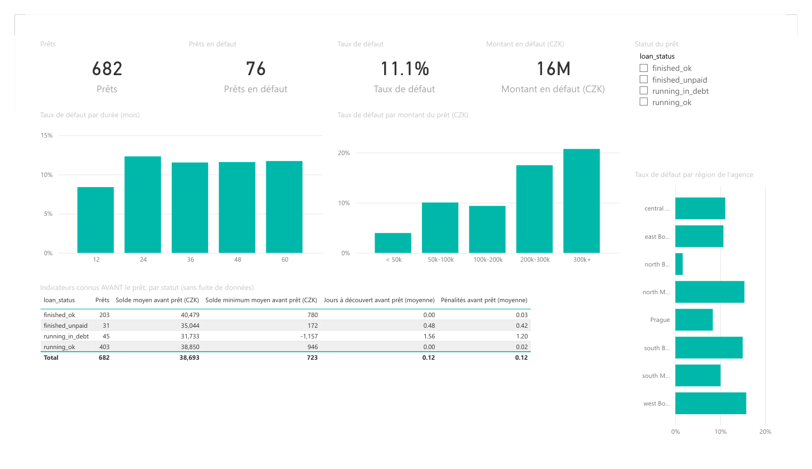
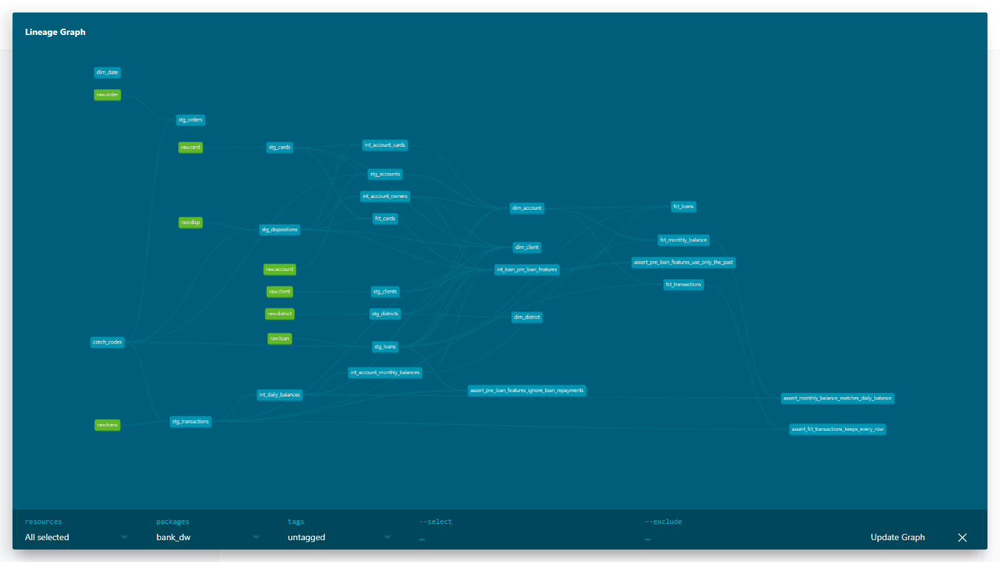
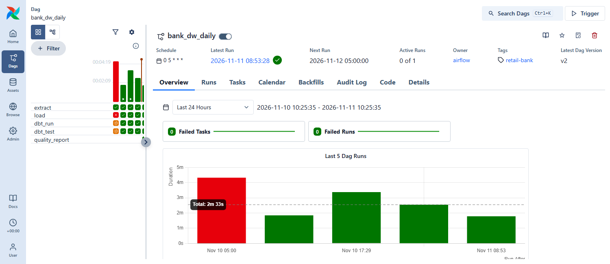

# Entrepôt de données bancaire (Retail Bank Data Warehouse)

[](https://github.com/SalmaBouhmid/retail-bank-data-warehouse/actions/workflows/ci.yml)
· [English version](README.md)

Un **entrepôt de données bancaire** construit sur les **vraies données anonymisées d'une banque de détail** :
ingestion automatisée → PostgreSQL → modèles **dbt** testés (schéma en étoile) → **reporting Power BI** pour la direction
(activité, clientèle, risque de crédit), le tout lancé chaque jour par **Airflow** dans **Docker**.

> **Le pitch en 30 secondes.** J'ai pris les données publiques d'une banque de détail tchèque (5 369 clients,
> 1 056 320 transactions, 682 prêts, 1993–1998) et j'ai construit ce que construit l'équipe data d'une banque :
> un script Python copie la source en Parquet, la charge dans PostgreSQL, dbt la transforme en schéma en étoile avec
> 121 tests automatiques, un rapport qualité signale ce qui semble faux, et Airflow lance le tout chaque matin.
> Au-dessus, un rapport Power BI répond à des questions métier, par exemple « quels prêts tournent mal ? »
> (11,1 % des prêts sont en défaut) et « peut-on voir le risque *avant* d'accorder le prêt ? », avec uniquement les
> transactions antérieures à la date du prêt, pour que les indicateurs ne regardent jamais le futur.

## À propos des données (à lire)

- **Source :** le jeu de données « Berka » (PKDD'99 Discovery Challenge), publié par l'Université technique tchèque :
  <https://relational.fel.cvut.cz/dataset/Financial> (serveur MariaDB public, compte invité en lecture seule indiqué sur cette page).
- Ce sont des **données réelles anonymisées** d'une **banque tchèque**, de **1993 à 1998**, très utilisées en recherche
  et en enseignement. Ce ne sont pas des données d'une banque marocaine et elles ne sont pas récentes.
- Les montants sont en **couronnes tchèques (CZK)**. Aucune conversion de devise n'est faite.
- Les codes sont en tchèque (`PRIJEM` = crédit, `VYDAJ` = débit, `VYBER` = retrait d'espèces…). Ils sont traduits par
  une table de correspondance documentée (seed dbt [transform/seeds/czech_codes.csv](transform/seeds/czech_codes.csv)),
  pas en dur dans le code.

| Table | Lignes | Contenu |
|---|---:|---|
| `client` | 5 369 | clients (date de naissance, sexe, district) |
| `account` | 4 500 | comptes |
| `disp` | 5 369 | liens client ↔ compte (titulaire / utilisateur) |
| `card` | 892 | cartes bancaires |
| `loan` | 682 | prêts (statut A, B, C, D) |
| `order` | 6 471 | ordres permanents |
| `trans` | 1 056 320 | transactions |
| `district` | 77 | données démographiques par district |

Les nombres de lignes viennent du manifeste d'extraction et sont vérifiés par `tests/test_raw_files.py`.

## Architecture



| Outil | Rôle |
|---|---|
| Python (pyarrow, SQLAlchemy, pymysql, psycopg2) | extraction en Parquet, chargement dans PostgreSQL |
| PostgreSQL 17 | l'entrepôt |
| dbt (dbt-postgres) | transformations SQL, tests et documentation |
| Airflow 3 | orchestration quotidienne, relances, historique des exécutions et logs |
| Docker Compose | PostgreSQL + Airflow en une commande |
| Power BI Desktop | reporting métier (projet enregistré en PBIP, lisible dans Git) |
| pytest, ruff, GitHub Actions | tests et intégration continue |

### Schéma en étoile (schéma `marts`)

- **Dimensions :** `dim_client`, `dim_account`, `dim_district`, `dim_date`.
- **Faits :** `fct_transactions` (1 ligne par transaction), `fct_monthly_balance` (1 ligne par compte et par mois),
  `fct_loans` (1 ligne par prêt, avec les indicateurs avant prêt), `fct_cards` (1 ligne par carte).
- **Indicateurs avant prêt sans fuite de données :** pour chaque prêt, l'ancienneté, le solde minimum, les jours en
  solde négatif et les intérêts de pénalité sont calculés **uniquement avec les transactions datées strictement avant
  le prêt**. Un test dbt (`assert_pre_loan_features_use_only_the_past`) échoue si une transaction postérieure est utilisée.

## Résultats (tous les chiffres viennent de l'entrepôt construit sur les données complètes)

| Question | Réponse |
|---|---|
| Combien de prêts sont en défaut (statut B ou D) ? | **76 sur 682 = 11,1 %**, soit **15 580 152 CZK** |
| Les clients en défaut sont-ils différents *avant* le prêt ? | Oui, en moyenne : solde minimum **−615 CZK** contre **891 CZK**, **1,12** jour en solde négatif contre **0,00**, **0,88** intérêt de pénalité contre **0,02** (76 prêts en défaut contre 606 autres) |
| Les données sont-elles fiables ? | Statut global **warning** (aucune erreur) : 78 contrôles, 66 ok, 8 info, 4 avertissements, par ex. 14 transactions en double, 162 montants nuls, 307 ruptures dans l'enchaînement des soldes sur 810 268 jours-comptes |

Ces moyennes décrivent les données ; avec 682 prêts, c'est une analyse, pas un modèle de scoring.

## Captures

**Power BI : vue d'ensemble** ([rapport PDF complet](docs/powerbi_report.pdf))



**Power BI : clients & activité, et risque crédit**




**Lineage dbt** (21 modèles, 1 seed, 8 sources, 121 tests de données)



**Airflow :** le DAG quotidien et son historique. La première exécution planifiée a échoué (c'est ainsi que le
pipeline a révélé un bug de chargement, corrigé depuis) ; les exécutions suivantes sont vertes.



## Lancer le projet

Prérequis : Docker Desktop, Git, Python 3.11+ (pour lancer les étapes à la main), Power BI Desktop (seulement pour le rapport).

1. Cloner le dépôt et créer ses réglages locaux :

   ```bash
   git clone https://github.com/SalmaBouhmid/retail-bank-data-warehouse.git
   cd retail-bank-data-warehouse
   cp .env.example .env   # puis choisir son propre WAREHOUSE_PG_PASSWORD dans .env
   ```

2. Démarrer PostgreSQL et Airflow :

   ```bash
   docker compose up -d --build
   ```

3. Ouvrir Airflow sur <http://localhost:8081>, puis lancer le DAG `bank_dw_daily` (bouton *Trigger*).
   La première exécution télécharge les données depuis Prague (environ 8 minutes), les charge, lance dbt et écrit le rapport qualité.

Ou lancer chaque étape à la main (PostgreSQL de l'étape 2 doit tourner) :

```bash
python -m pip install -r requirements.txt
python -m venv .venv && .venv/Scripts/python -m pip install -r requirements-dbt.txt   # .venv/bin/python sous Linux/macOS
python -m bank_dw.extract          # source -> data/raw/*.parquet
python -m bank_dw.load             # Parquet -> schéma raw
python -m bank_dw.run_dbt build    # seed + modèles + tests dbt
python -m bank_dw.quality          # reports/quality_report.html
python -m bank_dw.run_dbt docs generate
python -m pytest
```

Power BI : ouvrir `powerbi/BankDW.pbip`, saisir l'utilisateur et le mot de passe PostgreSQL de son `.env` quand c'est demandé, puis *Actualiser*.

## Tests et intégration continue

- **dbt :** 121 tests de données (`unique`, `not_null`, `relationships`, `accepted_values` et 4 tests personnalisés).
- **pytest :** 80 tests (extraction, chargement, rapport qualité, cohérence du projet Power BI…), dont les 4 tests du DAG qui tournent dans le conteneur Airflow.
- **GitHub Actions** ([.github/workflows/ci.yml](.github/workflows/ci.yml)) : à chaque push, ruff, puis l'entrepôt est
  reconstruit sur un PostgreSQL temporaire à partir d'un petit échantillon des vraies données
  ([tests/fixtures/berka_sample](tests/fixtures/berka_sample), fabriqué par [scripts/make_ci_sample.py](scripts/make_ci_sample.py)) :
  `dbt build`, rapport qualité et pytest.

## Organisation du dépôt

```
bank_dw/          Python : extract, load, run_dbt, quality
transform/        projet dbt (seeds, staging, intermediate, marts, tests)
airflow/dags/     le DAG bank_dw_daily
docker/           image Airflow et script d'initialisation PostgreSQL
powerbi/          projet Power BI (PBIP : modèle sémantique + rapport)
docs/             captures et PDF du rapport
tests/            tests pytest et échantillon pour la CI
```

## Autrice

Salma Bouhmid, étudiante en DUT data engineering.
Données : jeu de données Berka, PKDD'99, via le CTU Prague Relational Dataset Repository.
