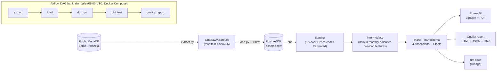
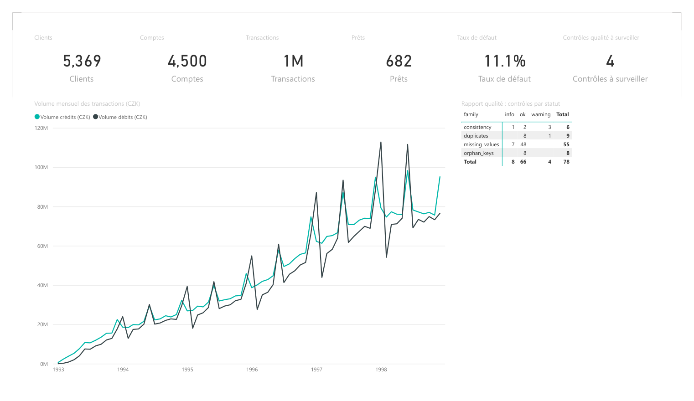
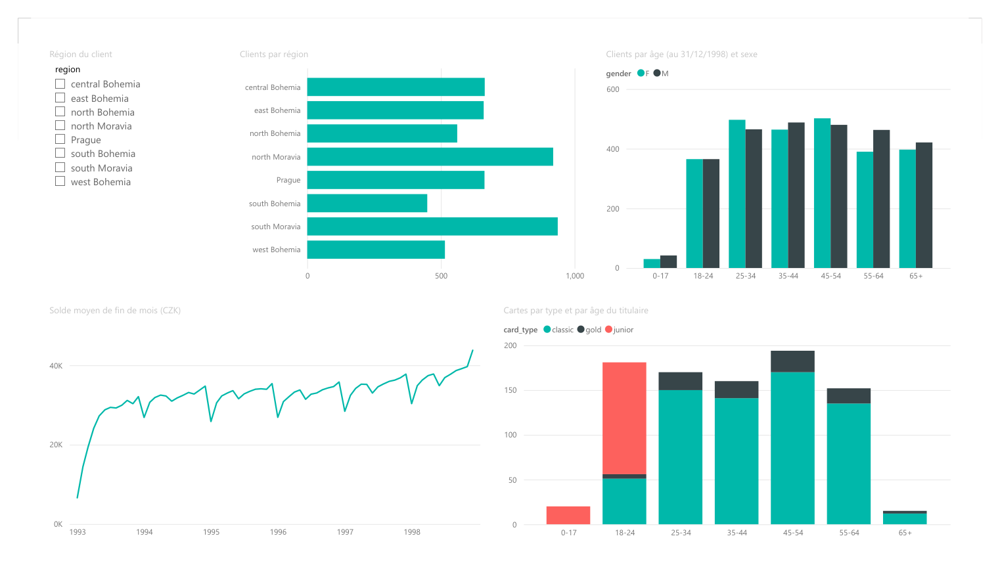
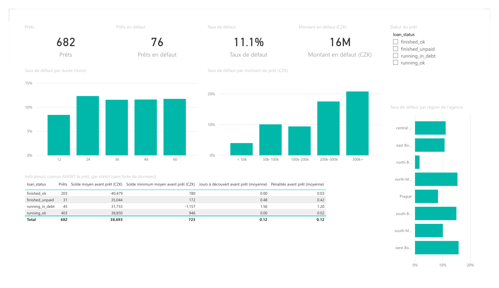
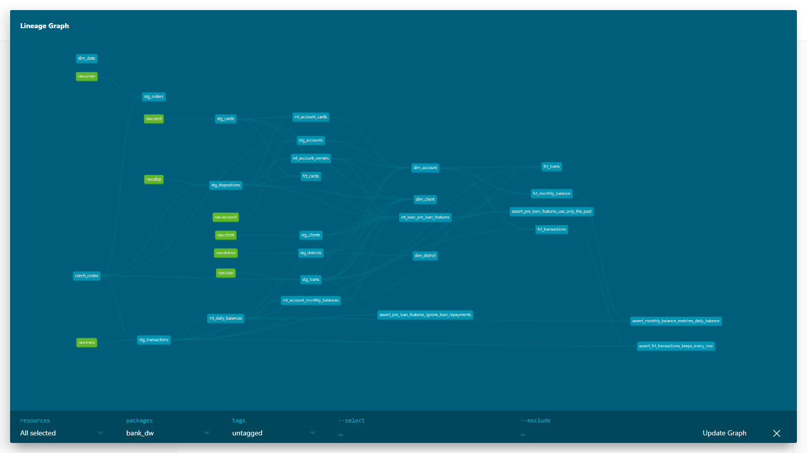
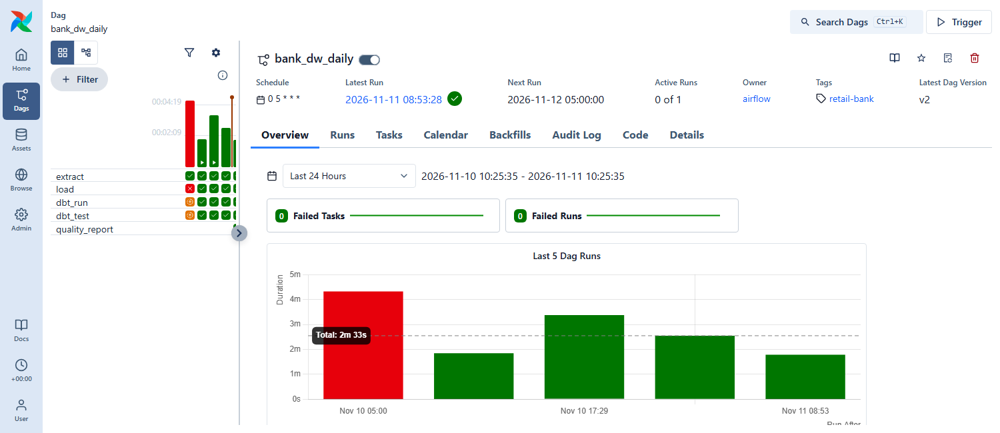

# Retail Bank Data Warehouse

[](https://github.com/SalmaBouhmid/retail-bank-data-warehouse/actions/workflows/ci.yml)
· [Version française](README.fr.md)

A **banking data warehouse** built on the **real, anonymised data of a retail bank**:
automated ingestion → PostgreSQL → tested **dbt** models (star schema) → **Power BI** reporting for management
(activity, customers, credit risk), the whole pipeline run every day by **Airflow** in **Docker**.

> **30-second pitch.** I took the public data of a Czech retail bank (5,369 clients, 1,056,320 transactions,
> 682 loans, 1993–1998) and built what a bank's data team builds: a Python job copies the source into Parquet,
> loads it into PostgreSQL, dbt turns it into a star schema with 121 automatic tests, a quality report flags
> what looks wrong, and Airflow runs it all every morning. On top, a Power BI report answers business questions,
> for example "which loans go bad?" (11.1 % of loans are in default) and "can we see the risk *before* granting
> the loan?", using only the transactions made before the loan date, so the indicators never peek into the future.

## About the data (please read)

- **Source:** the "Berka" dataset (PKDD'99 Discovery Challenge), published by the Czech Technical University:
  <https://relational.fel.cvut.cz/dataset/Financial> (public MariaDB server, read-only guest account given on that page).
- These are **real, anonymised data** of a **Czech bank**, from **1993 to 1998**, widely used in research and teaching.
  They are not data of a Moroccan bank and they are not recent.
- Amounts are in **Czech crowns (CZK)**. No currency conversion is made.
- Codes are in Czech (`PRIJEM` = credit, `VYDAJ` = debit, `VYBER` = cash withdrawal…). They are translated through a
  documented dbt seed ([transform/seeds/czech_codes.csv](transform/seeds/czech_codes.csv)), not hard-coded.

| Table | Rows | Content |
|---|---:|---|
| `client` | 5,369 | clients (birth date, sex, district) |
| `account` | 4,500 | accounts |
| `disp` | 5,369 | client ↔ account links (owner / user) |
| `card` | 892 | credit cards |
| `loan` | 682 | loans (status A, B, C, D) |
| `order` | 6,471 | standing orders |
| `trans` | 1,056,320 | transactions |
| `district` | 77 | demographic data by district |

Row counts come from the extraction manifest and are checked by `tests/test_raw_files.py`.

## Architecture



| Tool | Role |
|---|---|
| Python (pyarrow, SQLAlchemy, pymysql, psycopg2) | extraction to Parquet, loading into PostgreSQL |
| PostgreSQL 17 | the warehouse |
| dbt (dbt-postgres) | SQL transformations, tests and documentation |
| Airflow 3 | daily orchestration, retries, run history and logs |
| Docker Compose | PostgreSQL + Airflow with one command |
| Power BI Desktop | business reporting (project saved as PBIP, readable in Git) |
| pytest, ruff, GitHub Actions | tests and continuous integration |

### Star schema (schema `marts`)

- **Dimensions:** `dim_client`, `dim_account`, `dim_district`, `dim_date`.
- **Facts:** `fct_transactions` (1 row per transaction), `fct_monthly_balance` (1 row per account and month),
  `fct_loans` (1 row per loan, with the pre-loan features), `fct_cards` (1 row per card).
- **Pre-loan features without data leakage:** for each loan, history length, minimum balance, days with a negative
  balance and penalty interest are computed **only from transactions dated strictly before the loan date**.
  A dbt test (`assert_pre_loan_features_use_only_the_past`) fails if a later transaction is used.

## Results (all figures come from the warehouse built from the full data)

| Question | Answer |
|---|---|
| How many loans are in default (status B or D)? | **76 of 682 = 11.1 %**, i.e. **15,580,152 CZK** |
| Do defaulting clients look different *before* the loan? | Yes, on average: minimum balance **−615 CZK** vs **891 CZK**, **1.12** days with a negative balance vs **0.00**, **0.88** penalty-interest entries vs **0.02** (76 defaulting loans vs 606 others) |
| Are the data reliable? | Overall status **warning** (no error): 78 checks, 66 ok, 8 info, 4 warnings, e.g. 14 duplicated transactions, 162 zero amounts, 307 breaks in the balance chain out of 810,268 account-days |

These averages describe the data; with 682 loans they are an analysis, not a credit-scoring model.

## Screenshots

**Power BI: overview** ([full PDF report](docs/powerbi_report.pdf))



**Power BI: customers & activity, and credit risk**




**dbt lineage** (21 models, 1 seed, 8 sources, 121 data tests)



**Airflow:** the daily DAG and its run history. The first scheduled run failed (that is how the pipeline revealed
a loading bug, fixed since); the following runs are green.



## Run it

Requirements: Docker Desktop, Git, Python 3.11+ (for running the steps by hand), Power BI Desktop (for the report only).

1. Clone the repository and create your local settings:

   ```bash
   git clone https://github.com/SalmaBouhmid/retail-bank-data-warehouse.git
   cd retail-bank-data-warehouse
   cp .env.example .env   # then choose your own WAREHOUSE_PG_PASSWORD in .env
   ```

2. Start PostgreSQL and Airflow:

   ```bash
   docker compose up -d --build
   ```

3. Open Airflow at <http://localhost:8081>, then run the DAG `bank_dw_daily` (button *Trigger*).
   The first run downloads the data from Prague (about 8 minutes), loads it, runs dbt and writes the quality report.

Or run each step by hand (PostgreSQL from step 2 must be running):

```bash
python -m pip install -r requirements.txt
python -m venv .venv && .venv/Scripts/python -m pip install -r requirements-dbt.txt   # .venv/bin/python on Linux/macOS
python -m bank_dw.extract          # source -> data/raw/*.parquet
python -m bank_dw.load             # Parquet -> schema raw
python -m bank_dw.run_dbt build    # dbt seed + models + tests
python -m bank_dw.quality          # reports/quality_report.html
python -m bank_dw.run_dbt docs generate
python -m pytest
```

Power BI: open `powerbi/BankDW.pbip`, enter the PostgreSQL user and password of your `.env` when asked, then *Refresh*.

## Tests and continuous integration

- **dbt:** 121 data tests (`unique`, `not_null`, `relationships`, `accepted_values` and 4 custom tests).
- **pytest:** 80 tests (extraction, loading, quality report, Power BI project consistency…), of which the 4 DAG tests run inside the Airflow container.
- **GitHub Actions** ([.github/workflows/ci.yml](.github/workflows/ci.yml)): on every push, ruff, then the warehouse is
  rebuilt on a temporary PostgreSQL from a small sample of the real data
  ([tests/fixtures/berka_sample](tests/fixtures/berka_sample), made by [scripts/make_ci_sample.py](scripts/make_ci_sample.py)):
  `dbt build`, quality report and pytest.

## Repository layout

```
bank_dw/          Python: extract, load, run_dbt, quality
transform/        dbt project (seeds, staging, intermediate, marts, tests)
airflow/dags/     the DAG bank_dw_daily
docker/           Airflow image and PostgreSQL init script
powerbi/          Power BI project (PBIP: semantic model + report)
docs/             screenshots and PDF of the report
tests/            pytest tests and the CI sample
```

## Author

Salma Bouhmid, data engineering student (DUT).
Data: Berka dataset, PKDD'99, via the CTU Prague Relational Dataset Repository.
